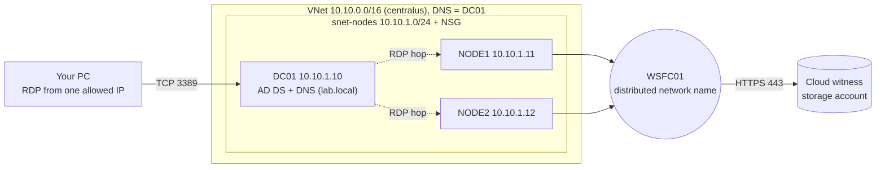
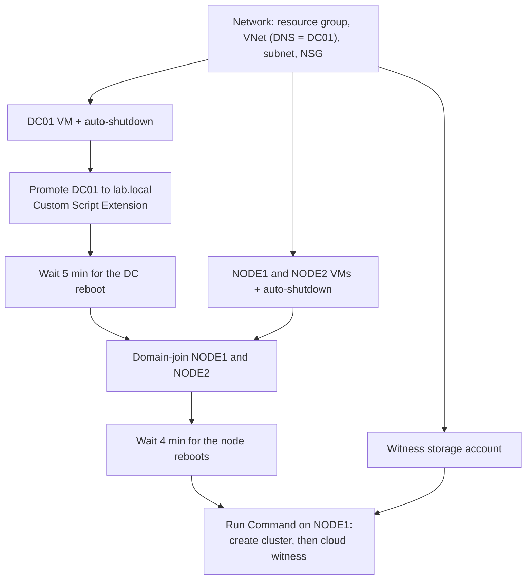

# Azure Windows Server Failover Cluster Lab (Terraform)


> One `terraform apply` builds a domain controller, two domain-joined Windows Server nodes, a failover cluster and a cloud witness in Azure. Tested end to end from an empty resource group in about 24 minutes.

I built this lab to combine my background in Windows Server clustering and high availability with infrastructure as code. Everything is automated: the network, the VMs, the Active Directory forest, the domain joins, the cluster and the witness. A small GitHub Actions workflow checks formatting and validity on every push.

| | |
|---|---|
| **Stack** | Terraform (azurerm 4.x, random, time), Azure VMs, Windows Server 2022, AD DS, Windows Server Failover Clustering, GitHub Actions |
| **Size** | 24 Terraform resources, 3 VMs |
| **Build time** | About 24 minutes for plan and apply from zero (tested 2026-11-08) |
| **Tested with** | Terraform 1.17.0, azurerm 4.81.0, Azure CLI 2.91.0, region `centralus` |

**Contents:** [What it builds](#what-it-builds) · [What this demonstrates](#what-this-demonstrates) · [Deployment flow](#deployment-flow) · [Quick start](#quick-start) · [How it works](#how-it-works) · [Design decisions](#design-decisions-and-trade-offs) · [Verification](#verification-and-failover-test) · [Cost and cleanup](#cost-and-cleanup) · [Security and limitations](#security-notes-and-known-limitations) · [Troubleshooting log](#troubleshooting-log) · [Reference](#reference) · [Roadmap](#roadmap)

## What it builds



- **DC01** is the only machine with a public IP, and the NSG allows RDP to it only from one address (`/32`) that you set. The nodes have no public IP, so you reach them by RDP from DC01.
- The VNet's DNS server is DC01, so the nodes can find the `lab.local` domain.
- Every VM has a nightly auto-shutdown schedule.

## What this demonstrates

**Terraform**
- Remote state in Azure Storage with state locking
- `for_each` over a map, implicit references and explicit ordering with `depends_on` and `time_sleep`
- Generated secrets (`random_password`), sensitive outputs, and protected extension settings
- Variable validation, saved plans (`plan -out`), `-replace` and `plan -destroy`
- VM extensions and Run Command for guest configuration
- CI with `fmt -check`, `init -backend=false` and `validate`

**Windows Server and Azure**
- Unattended AD DS forest promotion and domain join
- Failover clustering in Azure: distributed network name and cloud witness
- A documented troubleshooting log built from real failures (see below)

## Deployment flow



Timings from the tested run (approximate):

| Stage | Time |
|---|---|
| Network, VMs, witness account (in parallel) | 1 to 2 min |
| DC promotion extension | 5 min |
| Wait for DC reboot | 5 min |
| Node domain joins (in parallel) | under 1 min |
| Wait for node reboots | 4 min |
| Cluster creation and witness | 4 min |

## Quick start

### Prerequisites

- Terraform 1.5 or newer (tested with 1.17.0), Azure CLI, and Git
- An Azure subscription where you can create three 2-vCPU VMs. Some subscriptions restrict VM sizes by region, so check first (an empty `restriction` means available):

  ```powershell
  az vm list-skus --location centralus --size Standard_B2ms --resource-type virtualMachines --query "[].{name:name, restriction:restrictions[0].reasonCode}" -o table
  az vm list-usage --location centralus --query "[?name.value=='cores' || name.value=='standardBSFamily'].{name:name.localizedValue, used:currentValue, limit:limit}" -o table
  ```

  The lab needs 6 vCPUs in total.

### 1. Sign in

```powershell
az login
az account set --subscription "<name or id>"
$env:ARM_SUBSCRIPTION_ID = (az account show --query id -o tsv)
```

The azurerm 4.x provider requires a subscription ID, and this variable only lasts for the current terminal window.

### 2. Create the state storage account (one time, outside Terraform)

```powershell
$rg = "rg-tfstate"
$sa = "sttfstate$(Get-Random -Minimum 10000 -Maximum 99999)"
az group create --name $rg --location eastus
az storage account create --name $sa --resource-group $rg --location eastus --sku Standard_LRS --min-tls-version TLS1_2 --allow-blob-public-access false
az storage container create --name tfstate --account-name $sa --auth-mode key
$sa
```

### 3. Configure

Put the printed account name in `backend.tf`:

```hcl
terraform {
  backend "azurerm" {
    resource_group_name  = "rg-tfstate"
    storage_account_name = "<your state account>"
    container_name       = "tfstate"
    key                  = "wsfc-lab.tfstate"
  }
}
```

Create `terraform.tfvars` (git-ignored) with your public IP, which is the only address allowed to RDP. See `terraform.tfvars.example`:

```hcl
allowed_rdp_cidr = "203.0.113.10/32"
```

### 4. Deploy

```powershell
terraform init
terraform plan -out main.tfplan
terraform apply main.tfplan
```

The plan should end with `Plan: 24 to add, 0 to change, 0 to destroy.` Applying the saved plan runs exactly what you reviewed.

### 5. Connect

The admin password is generated and never committed. Copy it to the clipboard and open RDP to DC01:

```powershell
terraform output -raw admin_password | Set-Clipboard
mstsc /v:$(terraform output -raw dc01_public_ip)
```

Sign in as `LAB\labadmin`. From DC01, `mstsc /v:10.10.1.11` reaches NODE1 and `mstsc /v:10.10.1.12` reaches NODE2.

### 6. Verify

See [Verification and failover test](#verification-and-failover-test).

### 7. Destroy

```powershell
terraform destroy
```

This removes the whole lab. The state storage account was created outside Terraform, so delete it yourself when you no longer need it (`az group delete --name rg-tfstate`).

## How it works

**Domain controller** (`dc_promotion.tf`). A Custom Script Extension runs a PowerShell script on DC01. It installs the AD DS role and runs `Install-ADDSForest` for `lab.local` with `-NoRebootOnCompletion`, then schedules a restart 30 seconds later. The delayed restart lets the extension report success first. The script checks whether the machine is already a domain controller and exits if so, so it is safe to re-run.

**Domain join** (`nodes.tf`). NODE1 and NODE2 are created with `for_each` over the `node_names` map. A `time_sleep` of 5 minutes waits for the DC to reboot, then the `JsonADDomainExtension` joins each node to the domain. The VNet's DNS setting points at DC01, so name resolution works from the first boot.

**Cluster and witness** (`cluster.tf`). After a second `time_sleep` of 4 minutes for the node reboots, an `azurerm_virtual_machine_run_command` runs a script on NODE1:

1. It waits until both nodes answer over WinRM.
2. It writes a worker script and registers a scheduled task that runs it as `LAB\labadmin`.
3. The worker installs Failover Clustering on both nodes and runs `New-Cluster` with a distributed network name. If a cluster already exists, creation is skipped.
4. Back in the main script, `Set-ClusterQuorum -CloudWitness` configures the witness.

The admin password and the witness key are passed as protected parameters, so they are not part of the script text. For reference, the automation is equivalent to:

```powershell
Invoke-Command -ComputerName NODE1,NODE2 -ScriptBlock { Install-WindowsFeature Failover-Clustering -IncludeManagementTools }
New-Cluster -Name WSFC01 -Node NODE1,NODE2 -NoStorage -ManagementPointNetworkType Distributed
Set-ClusterQuorum -CloudWitness -AccountName "<witness account>" -AccessKey $key
```

## Design decisions and trade-offs

| Decision | Why | Trade-off |
|---|---|---|
| Distributed network name for the cluster | A cluster IP address needs an Azure internal load balancer before clients can reach it. A distributed network name registers the node IPs in DNS instead. | The cluster name resolves to both node IPs. Fine for management, not a single client endpoint. |
| Cloud witness | Two nodes need a third vote to survive losing one. A storage account is cheaper and simpler than a third VM or a shared disk. | The nodes need outbound HTTPS to the storage endpoint. |
| Run Command plus a scheduled task | Run Command's `run_as_user` logon had no network credentials (error 1312). A scheduled task logon keeps them, so the worker can reach NODE2 and create the cluster object in AD. | More moving parts than a single script. |
| `time_sleep` between stages | Extensions report success before the VM restarts, so dependent steps would start too early. | Fixed delays, not readiness checks. The cluster script does poll WinRM before it starts. |
| Remote state in Azure Storage | Shared state with locking, and secrets stay out of the repo. | The state account is a bootstrap step outside Terraform. |
| Public IP only on DC01 | The nodes are not exposed, and DC01 doubles as the jump host. | A public IP is billed and exposed to one allowed address. Azure Bastion would be cleaner. |
| `centralus`, `Standard_B2ms` | `eastus` sizes were restricted for the test subscription. B2ms (2 vCPU, 8 GB) is the smallest size that runs a DC and cluster nodes comfortably. | Check size and quota in your subscription. |
| Protected settings, and no transcripts in scripts that receive secrets | Keeps the password and key out of script text and logs. | The values still reach the process command line, so a transcript (or any logging of the command line) would record them. |

## Verification and failover test

Check the domain and the cluster without logging in:

```powershell
az vm run-command invoke --resource-group rg-wsfc-lab --name DC01 --command-id RunPowerShellScript --scripts "Get-ADComputer -Filter * | Select-Object Name | Format-Table | Out-String" --query "value[0].message" -o tsv
az vm run-command invoke --resource-group rg-wsfc-lab --name NODE1 --command-id RunPowerShellScript --scripts "Get-ClusterNode | Format-Table Name,State | Out-String; Get-ClusterQuorum | Format-List | Out-String; Get-ClusterResource | Format-Table Name,State | Out-String" --query "value[0].message" -o tsv
```

Expected:
- AD lists `DC01`, `NODE1`, `NODE2` and the cluster object `WSFC01`.
- Both nodes are `Up`, `QuorumResource` is `Cloud Witness`, and the `Cloud Witness` and `Cluster Name` resources are `Online`.

The cluster script also writes a log you can read:

```powershell
az vm run-command invoke --resource-group rg-wsfc-lab --name NODE1 --command-id RunPowerShellScript --scripts "Get-Content C:\create-cluster.log" --query "value[0].message" -o tsv
```

**Failover test.** With NODE2 stopped, the cluster stays online because the witness holds the third vote:

```text
PS> Stop-ClusterNode -Name NODE2
PS> Get-ClusterNode
NODE1 Up
NODE2 Down

PS> Get-ClusterResource
Cloud Witness  Online
Cluster Name   Online

PS> Get-ClusterQuorum
Cluster  QuorumResource
WSFC01   Cloud Witness

PS> Start-ClusterNode -Name NODE2
PS> Get-ClusterNode
NODE1 Up
NODE2 Up
```

## Cost and cleanup

- Three `Standard_B2ms` VMs, StandardSSD OS disks, a Standard static public IP and a small storage account. Check current prices for your region.
- Each VM has an auto-shutdown at 23:00 Costa Rica time (`Central America Standard Time`), which deallocates it. Change `shutdown_time` and `shutdown_timezone` to suit you.
- Shutting down from inside Windows still bills compute. To stop billing without destroying the lab, deallocate:

  ```powershell
  foreach ($n in "DC01","NODE1","NODE2") { az vm deallocate --resource-group rg-wsfc-lab --name $n --no-wait }
  ```

  Start DC01 first, wait a few minutes, then start the nodes.
- `terraform destroy` removes everything the lab created.

## Security notes and known limitations

**What is in place**
- RDP is allowed from one IP address only, and the nodes have no public IP.
- Passwords are generated, not hardcoded, and are passed to guest scripts through protected settings and parameters.
- `terraform.tfvars`, state files and plan files are in `.gitignore`, and the state lives in a private storage account.
- CI needs no Azure credentials, so no secrets are stored in GitHub.
- After any accidental exposure of the witness key, rotate it with `az storage account keys renew`.

**Known limitations (this is a lab)**
- One generated password is used for the local admin, the domain admin and the directory services restore mode (DSRM) password. It is also stored in Terraform state. Production designs should use Key Vault, separate secrets and managed identities.
- The password is embedded in the script that promotes DC01 and passed through protected settings. The script no longer writes it to a log, but it is still stored in Terraform state.
- The nodes reach the witness storage endpoint through default outbound access. That feature is being phased out for new virtual networks, so a NAT gateway or a storage service endpoint is the durable fix.
- The cluster script and the join logic refer to `NODE1` and `NODE2` by name, so the `node_names` map is not yet a fully general node count.
- The cluster is created with `-NoStorage` and uses only a witness. There is no shared storage and a single domain controller.
- The 5-minute and 4-minute waits are time-based, so a slow region might need longer values.
- CI checks syntax and validity only. It does not deploy anything.

## Troubleshooting log

Real problems hit while building this.

| Symptom | Cause | Resolution |
|---|---|---|
| Every VM size `NotAvailableForSubscription` in `eastus` | The subscription was restricted for those sizes in that region, although quota was fine (20 vCPUs) | Scanned regions with `az vm list-skus`, moved to `centralus` (the region is a variable), then re-checked quota and the image |
| After changing the region the plan said `4 to add, 4 to destroy`, not `5 / 5` | The subnet was not in the replacement list because its own arguments hadn't changed, but it is deleted with the old VNet, so state would no longer match Azure | Discarded the plan, ran `terraform plan -destroy` and applied it, then planned and applied fresh. Compare the counts in a plan with what you expect before applying |
| `labadmin` was already a Domain Admin after promotion | Azure renames the built-in Administrator to the admin name you choose | Nothing to fix, no extra domain admin account needed |
| `dcdiag /q` reported `DFSREvent` and `SystemLog` failures right after promotion | Both tests look back 24 hours: the Azure guest agent restarted during promotion, and DFS Replication logged error 1355 while DNS and AD were still starting | Confirmed SYSVOL and NETLOGON were shared, services were running, and the targeted `dcdiag` tests (`sysvolcheck`, `advertising`, `netlogons`, `services`) passed |
| Dependent steps could start before DC01 had rebooted | The extension reports success before the delayed restart | `-NoRebootOnCompletion` with a 30-second delayed restart, plus a 5-minute `time_sleep` before the joins and a 4-minute one before the cluster |
| `Set-ClusterQuorum` failed with "error occurred while validating access to Azure" | The command used an example storage account name instead of the real one | Read the name from `terraform output -raw witness_account_name` |
| Run Command with `run_as_user` failed on the second node (error 1312, "A specified logon session does not exist") | The Run Command logon carried no network credentials, so `Invoke-Command` to NODE2 failed even though `Test-WSMan` passed | Registered a scheduled task with the domain admin's stored credentials, since a task logon keeps them |
| The witness key appeared in a log file | `Start-Transcript` recorded the process command line, which included the protected parameters | Removed the transcript from the main script, deleted the logs, rotated the key |
| `C:\promote-dc.log` on DC01 contained the encoded command line, and so the lab password | The promotion script used `Start-Transcript`, which records the process command line | Replaced the transcript with a plain progress log that never records the command line, and removed the old log. Verified by counting `EncodedCommand` matches in the script log and the extension handler logs (0 each) |
| "A resource with the ID ... already exists" on apply | A failed Run Command create left the object in Azure but not in Terraform state | Deleted it with `az vm run-command delete` and planned again (`terraform import` would also work) |

## Reference

<details>
<summary>Repository layout</summary>

| File | Purpose |
|---|---|
| `providers.tf` | Provider versions (azurerm, random, time) |
| `backend.tf` | Remote state in Azure Storage |
| `variables.tf` | All input variables |
| `main.tf` | Resource group, VNet (DNS = DC01), subnet, NSG |
| `compute.tf` | Generated admin password, DC01 VM, public IP, NIC, auto-shutdown |
| `dc_promotion.tf` | The DC promotion script and its Custom Script Extension |
| `nodes.tf` | NODE1 and NODE2, wait for the DC, domain join |
| `witness.tf` | Storage account for the cloud witness |
| `cluster.tf` | Wait for the nodes, then create the cluster and configure the witness |
| `outputs.tf` | IPs, admin user, and the sensitive password and witness key |
| `terraform.tfvars.example` | Template for your private `terraform.tfvars` |
| `.github/workflows/terraform.yml` | `fmt -check`, `init -backend=false` and `validate` on every push |

</details>

<details>
<summary>Input variables</summary>

| Variable | Default | Purpose |
|---|---|---|
| `allowed_rdp_cidr` | none (required) | Public IP in CIDR form allowed to RDP in, validated as a CIDR |
| `location` | `centralus` | Azure region |
| `prefix` | `wsfc` | Prefix for resource names |
| `vnet_address_space` | `["10.10.0.0/16"]` | VNet address space |
| `subnet_prefix` | `10.10.1.0/24` | Subnet for all VMs |
| `vm_size` | `Standard_B2ms` | Size of all VMs |
| `admin_username` | `labadmin` | Local admin, which becomes the domain admin |
| `dc_private_ip` | `10.10.1.10` | Static IP of the domain controller, also used as the VNet's DNS server |
| `node_names` | `NODE1 = 10.10.1.11`, `NODE2 = 10.10.1.12` | Cluster nodes and their static IPs |
| `domain_name` | `lab.local` | AD forest DNS name |
| `domain_netbios` | `LAB` | Domain NetBIOS name |
| `cluster_name` | `WSFC01` | Failover cluster name |
| `shutdown_time` | `2300` | Daily auto-shutdown time (HHmm) |
| `shutdown_timezone` | `Central America Standard Time` | Time zone for the shutdown schedule |

</details>

<details>
<summary>Outputs</summary>

| Output | Notes |
|---|---|
| `dc01_public_ip` | Public IP of DC01 |
| `dc01_private_ip` | `10.10.1.10` by default |
| `admin_username` | Admin account name |
| `admin_password` | Sensitive. Read with `terraform output -raw admin_password` |
| `witness_account_name` | Name of the witness storage account |
| `witness_account_key` | Sensitive |
| `resource_group_name` | Resource group of the lab |
| `subnet_id` | ID of the VM subnet |

</details>

## Roadmap

- Split the configuration into modules (network, domain controller, nodes)
- Replace default outbound access with a NAT gateway or a storage service endpoint
- Move secrets to Key Vault, with separate domain admin and DSRM passwords
- Azure Bastion instead of a public IP on DC01
- Shared storage: Storage Spaces Direct or an Azure shared disk
- A second domain controller
- Optional: a SQL Server failover cluster instance or Always On availability group on top of the cluster
- CI: add `tflint` and a security scanner, and a `plan` job that signs in with OIDC federation
