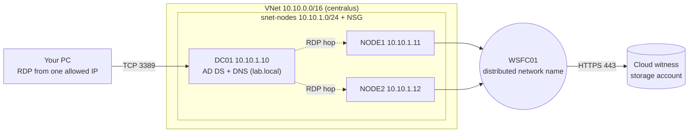

# Azure Windows Server Failover Cluster Lab (Terraform)


Infrastructure-as-code lab that builds a two-node **Windows Server Failover Cluster** in Azure with Terraform: a domain controller, two domain-joined cluster nodes, and a cloud witness. The domain controller promotion and the domain join are fully automated and were tested by rebuilding the VM from scratch. Cluster creation is done with documented PowerShell commands (automation is on the roadmap).

I built this to combine my background in Windows Server clustering and high availability with Terraform.

## Architecture



- **DC01** is the only machine with a public IP. The nodes have none, so you reach them by RDP from DC01.
- The VNet's DNS server is DC01, so the nodes can find the domain.
- The NSG allows RDP only from a single IP (`/32`) that you set in `terraform.tfvars`.

## What is automated

| Piece | How |
|---|---|
| Resource group, VNet, subnet, NSG | Terraform |
| DC01 VM (Windows Server 2022) with auto-shutdown | Terraform |
| AD DS install and forest `lab.local` | Terraform + Custom Script Extension |
| NODE1 / NODE2 VMs with auto-shutdown | Terraform (`for_each`) |
| Domain join | Terraform + `JsonADDomainExtension` (after a wait for the DC reboot) |
| Cloud witness storage account | Terraform |
| Cluster creation and witness configuration | PowerShell, documented below (not yet automated) |
| `terraform fmt` / `validate` checks | GitHub Actions |
| State | Remote backend in Azure Storage |

## Repository layout

| File | Purpose |
|---|---|
| `providers.tf` | Provider versions (azurerm, random, time) |
| `backend.tf` | Remote state in Azure Storage |
| `variables.tf` | Region, VM size, IPs, domain name, node map, shutdown schedule |
| `main.tf` | Resource group, VNet (DNS = DC01), subnet, NSG |
| `compute.tf` | Admin password, DC01 VM, public IP, NIC, auto-shutdown |
| `dc_promotion.tf` | PowerShell script that promotes DC01, run by a Custom Script Extension |
| `nodes.tf` | NODE1 / NODE2, wait for DC, domain join |
| `witness.tf` | Storage account for the cloud witness |
| `outputs.tf` | IPs, admin user, and sensitive password / witness key |
| `.github/workflows/terraform.yml` | `fmt`, `init -backend=false`, `validate` on every push |

## Prerequisites

- Terraform 1.5 or newer
- Azure CLI and Git
- An Azure subscription where you can create three 2-vCPU VMs in your chosen region (check quota and that the VM size is not restricted, see the troubleshooting section)

## How to run it

1. Clone the repo.
2. Sign in and pick a subscription:

   ```powershell
   az login
   az account set --subscription "<name or id>"
   $env:ARM_SUBSCRIPTION_ID = (az account show --query id -o tsv)
   ```

3. Create the storage account for Terraform state (one time):

   ```powershell
   $rg = "rg-tfstate"
   $sa = "sttfstate$(Get-Random -Minimum 10000 -Maximum 99999)"
   az group create --name $rg --location eastus
   az storage account create --name $sa --resource-group $rg --location eastus --sku Standard_LRS --min-tls-version TLS1_2 --allow-blob-public-access false
   az storage container create --name tfstate --account-name $sa --auth-mode key
   $sa
   ```

   Put the printed name in `backend.tf` as `storage_account_name`.

4. Create `terraform.tfvars` (it is git-ignored) with your public IP:

   ```hcl
   allowed_rdp_cidr = "203.0.113.10/32"
   ```

   See `terraform.tfvars.example`.

5. Build:

   ```powershell
   terraform init
   terraform plan -out main.tfplan
   terraform apply main.tfplan
   ```

   The first apply takes roughly 20 to 30 minutes, mostly the domain controller promotion and the node joins.

6. Log in. The admin password is generated and never committed:

   ```powershell
   terraform output -raw admin_password | Set-Clipboard
   mstsc /v:$(terraform output -raw dc01_public_ip)
   ```

   Use `LAB\labadmin`. From DC01, `mstsc /v:10.10.1.11` reaches NODE1.

## Creating the cluster (manual for now)

Run on NODE1 in an elevated PowerShell:

```powershell
Invoke-Command -ComputerName NODE1,NODE2 -ScriptBlock { Install-WindowsFeature Failover-Clustering -IncludeManagementTools }
Test-Cluster -Node NODE1,NODE2 -Ignore "Storage"
New-Cluster -Name WSFC01 -Node NODE1,NODE2 -NoStorage -ManagementPointNetworkType Distributed
```

A distributed network name is used because Azure does not support a traditional cluster IP without a load balancer.

Configure the cloud witness. Take the account name from `terraform output -raw witness_account_name` and the key from `terraform output -raw witness_account_key`, copy the key to the clipboard, then:

```powershell
$key = Get-Clipboard
Set-ClusterQuorum -CloudWitness -AccountName "<witness account name>" -AccessKey $key
Get-ClusterQuorum
```

## Failover test

With NODE2 stopped, the cluster stays online because the witness holds the third vote:

```text
PS> Stop-ClusterNode -Name NODE2
PS> Get-ClusterNode
NODE1 Up
NODE2 Down

PS> Get-ClusterResource
Cloud Witness  Online
Cluster Name   Online

PS> Get-ClusterQuorum
Cluster  QuorumResource
WSFC01   Cloud Witness

PS> Start-ClusterNode -Name NODE2
PS> Get-ClusterNode
NODE1 Up
NODE2 Up
```

## Cost and cleanup

- Three VMs (`Standard_B2ms`) plus a Standard public IP. Every VM has a nightly auto-shutdown at 23:00 (Costa Rica time).
- Shutting down from inside Windows still bills compute. Deallocate instead:

  ```powershell
  foreach ($n in "DC01","NODE1","NODE2") { az vm deallocate --resource-group rg-wsfc-lab --name $n --no-wait }
  ```

  Start DC01 first, wait a few minutes, then the nodes.
- `terraform destroy` removes the whole lab. The state storage account is created outside Terraform and is not removed.

## Security notes

- RDP is allowed only from one IP address. The nodes have no public IP.
- Passwords are generated with `random_password`, not hardcoded. They are stored in Terraform state, which lives in a private storage account. Treat the state as a secret.
- `terraform.tfvars`, state files and plan files are in `.gitignore`.
- The access key for the witness account is printed only to the clipboard, never committed.

## Troubleshooting log

Real problems hit while building this, and how they were resolved.

**Terraform could not download registry modules ("git must be available and on the PATH").** Git was missing from the PATH. Installing Git and opening a new terminal fixed it.

**All VM sizes were `NotAvailableForSubscription` in eastus.** Quota was fine (20 vCPUs), but the subscription was restricted for VM sizes in that region. I scanned other regions with `az vm list-skus` and found `centralus` available, then re-checked quota and the image there. The region is a variable, so moving was a one-line change.

**Plan after changing region showed 4 to add / 4 to destroy, not 5 / 5.** The subnet was not in the replacement list, because none of its own arguments changed, but deleting the old VNet deletes the subnet with it. Applying that plan would have left Terraform's state out of sync with Azure. I discarded the plan, ran `terraform plan -destroy`, applied it, then planned and applied fresh. Lesson: compare the counts in a plan against what you expect before applying.

**Azure renames the built-in Administrator to the admin name you choose.** After promoting DC01, the VM admin (`labadmin`) was already a Domain Admin and kept the same password. No extra domain admin account was needed.

**`dcdiag /q` reported `DFSREvent` and `SystemLog` failures right after promotion.** Both tests look back 24 hours. The events were the Azure guest agent restarting during promotion, and DFS Replication error 1355 while DNS and AD were still starting. SYSVOL and NETLOGON were shared and the targeted tests (`sysvolcheck`, `advertising`, `netlogons`, `services`) passed, so these were expected after promotion.

**The promotion script finishes before the VM reboots.** The Custom Script Extension runs `Install-ADDSForest -NoRebootOnCompletion` and schedules a restart 30 seconds later, so it can report success. A `time_sleep` resource makes the node domain joins wait for the DC to come back.

**Cluster IP in Azure.** A traditional cluster IP address is not usable without a load balancer, so the cluster is created with a distributed network name. The name resolves to both node IPs.

**`Set-ClusterQuorum` failed with "error occurred while validating access to Azure".** The command used an example storage account name instead of the real one. Always read the name from `terraform output -raw witness_account_name`. After exposing a key by mistake, rotate it with `az storage account keys renew` and reconfigure the witness with the new key.

## Roadmap

- Automate cluster creation with a Custom Script Extension, with a rebuild test like the one used for DC01
- Outbound access for the nodes through a NAT gateway or a storage service endpoint instead of relying on default outbound access
- Shared storage: Storage Spaces Direct or an Azure shared disk
- Azure Bastion instead of a public IP on DC01
- Optional: a SQL Server failover cluster instance or Always On availability group on top of the cluster

## License

MIT, or choose your own.
